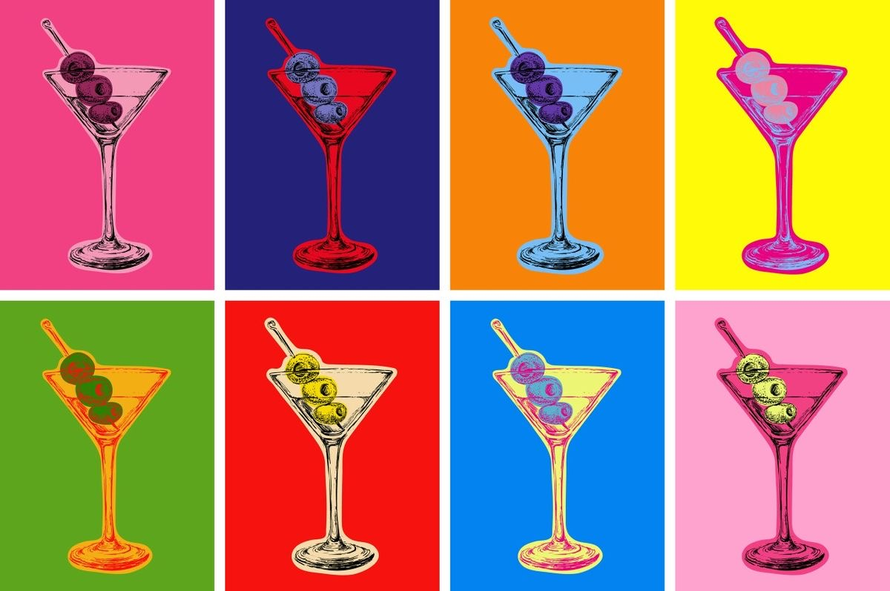

# Process

## Starting idea

I wanted an everyday action or scenario become more interesting. The idea developed from opening a cupboard or fridge and making the whole scene tilt into carrying a tray while absurd events happen around it. Then I come up with the idea of holding a type of liquid to avoid spilling it.

The core loop is: move two hands → change the tray position and tilt → see the liquid move or spill → adjust the hands again. The remaining amount gives the action a consequence.

## Visual development and typography

*Design rationale expanded on 26 October 2026.*

I compared several visual references and used ChatGPT image generation to explore black-and-white line drawings, flat 2D illustrations, more detailed scenes and different colour combinations. I eventually selected a Pop Art-inspired direction with retro comic illustration and screen-print textures. Comic bursts, bold flat shapes and grainy halftone shadows were the visual features I selected, rather than treating the game as a strict example of one art movement. The exaggerated visual language suited the absurd interruptions, while the close-up composition kept attention on the two hands, tray and liquid.

One reference I supplied used cyan, pale pink, red-orange and halftone shadows. I referred to its shapes and print texture, then developed my own palette around the three primary colours: red, yellow and blue. Yellow forms the background, blue defines the tray and shadows, and red highlights the tomato soup and comic accents. Reducing competing colours makes the separate objects feel part of the same visual system and creates a stronger visual impact. Cream and warm skin tones remain for the containers and hands, with small green garnish details; the palette is primarily red, yellow and blue rather than exclusively those three colours.

I paired Bangers headings with standard Barlow for instructions, buttons and small labels. Bangers supports the comic style and makes short titles expressive. I initially tried the rounder Fredoka for smaller text, but felt it made the interface too soft. Barlow gives the instructions a cleaner, more angular appearance without competing with the illustrations. I chose standard Barlow rather than Barlow Semi Condensed to keep longer instructions comfortably spaced. The intention is to make the visual identity energetic while keeping the controls and goal easy to read.

ChatGPT image generation supported the visual and palette exploration; I selected and revised the direction. The resulting mockups and runtime illustrations are AI-assisted, not entirely hand-drawn by me. The selected direction is in `assets/visual-direction.png`. P2's original creator and URL have not yet been identified and still need to be credited before submission. Describing the visual style does not replace that attribution; the third-party reference itself is not redistributed in this repository.

### Supplementary colour reference — 31 October 2026

*Reference supplied by me from Pinterest. Pinterest source supplied by me: [Pin reference](https://pin.it/4yfYqPwWG). Original creator and work title have not been verified. This is a third-party reference image, not my own artwork or a game asset.*

This image helps explain the Pop Art influence: it repeats an everyday object while changing the saturated background and object colours. I was interested in the bold contrast and graphic treatment of familiar objects. For the game, I used a more limited red, yellow and blue palette, combined with retro comic shapes and screen-print grain, to make the different objects feel visually consistent. Bangers reinforces the expressive comic character, while standard Barlow keeps the smaller instructions clear. I am adding this image as a supplementary reference for the design explanation; it is distinct from the earlier cyan/pink P2 reference.

## First implementation — 22 October 2026

The initial repository contained README and PROCESS templates. The first code version adds a desktop browser prototype, a live mirrored camera preview, two-hand palm detection, calibration, liquid loss and three events. Drawn hands, tray, bowl, liquid and drops are separate Canvas elements so they can respond to input. The approved image is visual guidance, not a static gameplay background.

Hand positions are sorted by their mirrored screen x coordinate. Their height difference determines an angle; their midpoint determines horizontal movement. The comfortable calibration pose is subtracted so the user does not need an exact prescribed resting angle. Smoothing reduces small jitter.

I kept the initial scope to wind, floor tilt and falling ball. They currently cycle; only the ball target varies. A larger randomized event library is planned, not claimed as implemented. The three drink choices currently share the same rules.

Interruption handling: loss of either hand freezes time and loss, then requires both hands plus a short countdown. Permission denial and model-loading failure offer keyboard mode. Tab changes pause, repeated start clicks are guarded, and the camera can be explicitly stopped.

## AI tools used

- ChatGPT conversation: concept development, interaction ideas, visual exploration and prompt drafting.
- ChatGPT image generation: visual mockups and palette variants.
- Codex: first HTML/CSS/JavaScript implementation, documentation and automated checks. I still need to review and understand the code before presenting it as coursework.
- Suggestion kept: use the difference between the two hand heights for tray tilt, with a keyboard demonstration mode.
- Suggestion changed/rejected: the early detailed 3D-like restaurant scenes were too complicated. I chose a close-up 2D composition with large hands and tray, simple event cues and a brighter palette. I also rejected muted/unnatural skin and soup colorways.

## Verification versus user trial

Automated physics checks are in `tests/physics.test.js`. Browser checks and camera limitations are recorded in `docs/VERIFICATION.md`. Automated checks are not a substitute for the required human trial.

## First user trial — 24 October 2026, afternoon

One participant tried the experience before I explained what it was or how it worked. Their name is omitted from this public record.

**Observation:** The participant did not understand what to do at the start. Unlike my own tests, they did not keep checking whether the camera could see their hands, so their hands frequently left the camera frame. They also did not understand why the tray was being disturbed. Across about three attempts, the liquid quickly reached 0%; this had not happened in my earlier testing. No exact scores or timings were recorded.

**Decision and response — 25 October 2026:** Add a separate instruction page between choosing a control mode and starting. Explain the 30-second goal, remaining-liquid score, two-hand tilt and sideways movement, keeping both hands fully visible, and tracking interruption/resume. Mention unexpected effects without naming specific hazards or adding per-event text warnings. Include an explicit start button and a back button. Also fix the alien's proportions by preserving its source image aspect ratio.

**Unresolved issue:** The repeated quick 0% results are recorded as a difficulty or tracking concern, not attributed to a proven cause. Difficulty was not changed in this revision. The participant has not yet tested the revised instructions, so their effectiveness and the actual average score remain unverified.

## Still to do before submission

Status updated 31 October: two participant trials are now documented. Re-testing the latest revision is still pending. Older dated entries below describe the state at their respective dates.

- Real two-hand camera test and comfort/sensitivity tuning.
- Re-test the revised instructions with a participant and record whether they help.
- Identify and credit P2's original source.
- Review and explain the hand-to-response code.
- Re-run from a fresh terminal, verify public repository access when signed out, and submit the repository URL through Canvas.

## Iteration — 23 October 2026

After trying the first prototype, I felt that 60 seconds was slightly too long, so I requested a 30-second round. The countdown, end condition and instructions were updated together. This is feedback from my own playtest, not the required trial with another person. Visual fidelity and stronger external events are next planned revisions; they are not implemented in this timing-only change.

## Visual and event iteration — 23 October 2026

After trying the prototype myself, I kept tomato soup and coffee and removed pumpkin soup. The earlier runtime shapes differed too much from the selected illustration, so I asked for closer printed-art visuals. Codex used ChatGPT image generation to produce separate transparent tray/hands, empty bowl, empty coffee cup with saucer, alien and bear assets based on the approved direction. The liquid is still drawn in code so it responds to tilt and drains. This is AI-assisted artwork, not a claim that I drew the assets manually.

The updated event set is floor tilt, falling ball, alien pull, slippery step and bear chase. The alien uses blue/red with tiny green lights, and the bear uses orange-red and blue print shadows. Events are shuffled with one of each per 30-second round. Floor tilt is sustained; slipping gives a decaying sideways jolt; the alien pulls an edge; bear pursuit causes oscillating bounce; the ball requires sideways avoidance. The background remains mostly yellow. Warning periods do not apply force, and time/forces stay frozen when tracking is interrupted.

Automated checks are recorded separately in docs/VERIFICATION.md. My own feedback does not replace the required trial with another person, which remains pending.

## Liquid and difficulty iteration — 23 October 2026

I requested closer liquid styling and a harder experience, aiming for about 55% remaining on average. Codex replaced the regular liquid dots with irregular seeded grain, added curved cream ribbons, floating garnish, tilt-dependent waves and textured splash highlights. Animation uses game elapsed time, so pausing or losing tracking freezes the visual motion too. Lower remaining volume reduces splash size.

The spill threshold changed from 0.18 to 0.14 radians, tilt loss from 27 to 46 percentage points per radian per second, and the rapid-motion penalty increased. Floor, alien, slip and bear disturbances were strengthened. The round remains 30 seconds and a level, steady tray still loses nothing. A simplified controller that compensates for 80% of an event with 0.3–0.7 second delay retained approximately 49–56%, excluding ball hits and real hand noise. This is a tuning estimate, not an observed human average. Real player trials are still needed to assess the 55% target.

Checks: seven existing tests passed, JavaScript syntax and whitespace checks passed, and 120 mocked Canvas render states covered five events, both drinks, four fill amounts and three tilt angles without exceptions or unbalanced Canvas saves. These are not a browser screenshot review or a real-camera trial of this revision.

## Surprise timing and comic accents — 23 October 2026

After testing, I felt the ball fell too slowly and the event labels made the surprises too predictable. I requested a much faster drop, one explanation at the start instead of text for each event, and visual accents closer to the approved still image. The attached detail showed a red jagged comic fan and cream speed streaks.

The ball now has a short 0.45-second landing-shadow cue followed by a 0.32-second fall to the collision point, rather than a 1.4-second descent. Its drawn position and collision use shared timing constants. Per-event names, instructions and ball-result messages were removed; tracking, permission and pause messages remain. The opening explains that random surprises can happen. Event order remains shuffled; directions and short gaps now also vary. Large asymmetric red comic fans and cream speed streaks sit behind the tray during stronger tilts, keeping the bright yellow field and the main illustration visible.

JavaScript syntax checks, whitespace checks and all seven existing tests passed. This revision still needs a real browser/camera playtest to judge whether the fast ball feels fair. The 55% average remains a playtest target, not a measured result.

## Typography, impact and hand authority — 25 October 2026

I selected Bangers for headings and score numerals, paired with Fredoka for instructions and controls. They load from Google Fonts with system fallbacks; external font requests do not contain camera images.

I reported that the fast ball deducted liquid without visibly shaking it. Codex added collision-only damped roll, sideways movement and vertical bounce, plus an impact contribution to the liquid wave. A successful dodge does not trigger this response; the existing 18% contact loss remains.

I also reported that lifting one hand could leave the tray looking level after disturbances. Code review found two possible contributors: calibration accepted a slanted pose as neutral, and an opposite external angle could cancel a deliberate hand angle. Calibration now waits for hands within 0.18 radians of level; hand angle gain is 1.25 and strong deliberate tilts reduce opposing event influence. Tracking loss still freezes the experience. These changes address plausible causes, not a confirmed diagnosis of the observed camera session. Nine automated tests pass, including new checks for impact-only response, impact decay and strong hand authority. Real-camera regression testing remains necessary, including the effect on difficulty and average score.

I requested two vision-obscuring effects as still-image previews before implementation. Earlier exact descriptions could not be reliably recovered, so tomato splashes on the view and steam clouds are explicitly new candidate proposals. Their generated previews are not integrated into the game, pending my selection.

## Foreground interruptions with motivated exits — 25 October 2026

I selected the cloth and fog previews but asked that the live tray and bowl never be duplicated. I changed the giant spider into a small decorative corner spider: it descends on a thread, builds a web, climbs away, and leaves the web until reset. It has no connection to forces or liquid loss.

Codex implemented foreground-only Canvas layers, not full still-image backgrounds. The blue/cream checked cloth drops in, obscures roughly 90% at its peak for about two seconds, then slides and rotates down one side over 0.65 seconds. It also adds modest faster-footstep motion. Dense cream fog forms, then disperses as cloud banks move apart and fade. One cloth and one fog interruption overlap the second and fourth shuffled hazards, with their second second coinciding with the normal force onset. The five original hazards remain; no event text warnings were restored.

A lens splash is conditional: more than 8 percentage points lost in a 0.6-second rolling window. It lasts 0.8 seconds including its downward-draining exit, uses the drink's color, and has a 1.4-second retrigger interval. Slow cumulative loss does not trigger it; the splash itself adds no liquid penalty. All layers use active game time and freeze during pause or tracking loss. Reset clears covers, splashes and webs.

Validation: 12 automated tests passed, including rolling-window/retrigger rules, cover timing and cloth-only footsteps; syntax/whitespace checks passed. A native Canvas harness rendered 36 frames across entry/hold/exit states for visual review. A mock-DOM keyboard round exercised instructions, gameplay, pause, finish and retry with actual Canvas drawing. This is not a real-camera/browser playtest; difficulty and visual feel still need my test. Generated stills remain visual references; moving foreground layers are code-drawn and may need further visual refinement.

## Standard Barlow and moving visitors — 25 October 2026

After comparing font specimens, I selected standard Barlow for body copy, buttons and small Canvas status labels, explicitly excluding Barlow Semi Condensed. Bangers remains the heading/score face. Google Fonts, README and font credits were updated.

I noticed that the spider's web floated away from the corner. Its origin is now the actual top-right corner of the normalized gameplay viewport (1120, 0); radiating threads and web arcs touch the top and right edges. The spider remains decorative and the web persists until reset.

I asked for the alien and bear to approach instead of remaining static. Both now move smoothly from smaller, distant positions toward closer positions over the event, increasing in size. The alien's beam follows its moving saucer; the bear's dust follows its moving feet. Both retain their source artwork aspect ratios. Motion uses active elapsed time, so pause and tracking loss freeze their positions and scale. Event forces and scoring rules are unchanged in this revision.

Validation for this revision: 12 existing automated tests passed, syntax and whitespace checks passed, and 12 actual Canvas frames were rendered to inspect distant/near visitor positions and the completed corner web. Real-browser font loading and camera play remain to be checked.

## Second user trial — 29 October 2026, Thursday afternoon

A classmate (Participant A, anonymised) tried the experience. Their hands moved outside the camera frame twice, causing pauses that interrupted the experience. I noticed that players did not always actively check the preview. This is two observed interruptions, not a claim that hands were frequently out of view. No additional score or timing data was recorded.

**Decision and revision — 31 October 2026:** I rejected adding a practice exercise. Instead, I requested clearer instruction hierarchy and a large English reminder, “KEEP BOTH HANDS IN CAMERA VIEW”, together with a 3–2–1 countdown after Start and camera calibration. The countdown does not consume the 30-second round; if either hand is lost before play, it resets to three until both return. Keyboard mode also has a countdown with its own English reminder. The main rules are larger/bolder, with secondary explanation reduced.

The preview now shows one red dot with a cream outline at each detected palm centre, a hand count and a dashed safe-area guide. Approaching the preview edge highlights the guide and prompts the player to move toward the centre. Missing detections remove the markers. Camera loss still freezes time and spilling; no new gameplay penalty was added for tracking failure.

I also reported that five recent rounds felt too similar. Previously each round contained all five hazards once, with covers tied to the second and fourth events. Codex changed this to 4–6 sampled disturbances, at least three distinct types, no immediate repeats, and varied start times, durations, directions, strengths and ball positions. Cloth/fog selection and spacing now vary independently (up to three covers), and spider appearance varies from 3–21 seconds. Conditional splashes remain tied to actual rapid liquid loss. The 55% score target has not been re-measured after these changes.

Validation: 13 automated tests passed, including 150 seeded random plans checked for variety, bounds and completion within 30 seconds. A simulated hand detector with native Canvas drawing exercised initial countdown, hand loss resetting that countdown, gameplay tracking loss, pause, result and retry. This is simulated camera validation, not a real-browser or human test of the revision. The participant has not yet tried these changes.
