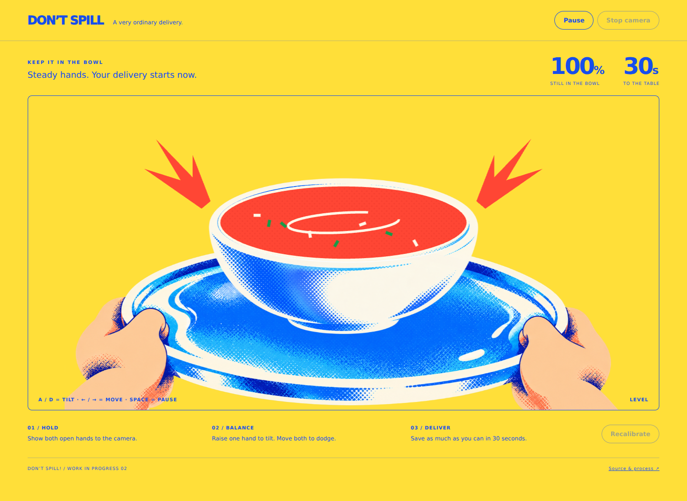

# Don't Spill!

A short, playful browser experience for students and other desktop users taking a break. Hold up both hands, balance a tray, and deliver as much soup as possible while the world interferes.



## Run

No build step or paid account is required. Install Python 3, then from a fresh terminal:

```sh
git clone https://github.com/kiwisfavmascara/Dont-Spill.git
cd Dont-Spill
python3 -m http.server 8000
```

Open **http://localhost:8000** in a current desktop Chrome or Edge browser. Do not open `index.html` directly. A hosted copy must use HTTPS for camera access. This repository has not yet enabled GitHub Pages.

## How to play

1. Choose tomato soup or coffee.
2. Select **Enable camera & try it**, read the instruction page and confirm, allow camera access, then show both open hands in the mirrored preview.
3. Hold your hands at the same height for calibration, then keep both hands visible during the large English reminder and 3–2–1 countdown. The 30-second timer begins afterward. Red palm markers show detection; the preview guide highlights hands nearing the edge. Raise one hand to tilt the tray; move both hands sideways to move it. Use **Recalibrate** if the resting angle feels wrong.
4. Watch the liquid and remaining percentage. Unexpected disturbances have no text warnings. Balance the tray and move sideways to dodge falling balls.
5. After 30 seconds, see how much remains. Retry or return home to change your order.

The program uses palm centres, not a special gripping gesture. Small movements are enough. Put the camera far enough away to see both hands.

**Keyboard fallback:** A/D tilt; left/right arrows move; Space pauses. It works even when camera permission is denied or the hand model cannot load. Pause and Stop camera are also visible buttons. If one hand disappears, time and loss freeze until both return and a short countdown finishes. Switching tabs pauses the experience.

## Dependencies and privacy

- Plain HTML, CSS, JavaScript modules and Canvas 2D.
- MediaPipe Tasks Vision **0.10.21**, loaded on demand from jsDelivr, including its WebAssembly files.
- Google's Hand Landmarker **float16 model, version 1**, loaded from Google Storage. Exact URLs are in `app.js`.
- Camera mode requires an internet connection to those providers, HTTPS/localhost, a camera, permission, and a browser supporting WebAssembly. Initial model loading can take time.
- Camera processing is in the browser. This application does not record, store, or upload frames. External providers receive ordinary requests for library/model assets. No microphone is requested.
- Stop camera or leave the page to release the camera. Keyboard mode is available without these external dependencies.

## Implementation

`physics.js` maps two palm positions to tray angle and horizontal position. `app.js` smooths that input and calculates loss; `events.js` schedules disturbances; `renderer.js` combines separate transparent printed-art sprites with a live Canvas liquid surface. The amount left is state, not a random score: sustained excessive tilt drains it, while ball collisions remove 18 percentage points. Each round samples 4–6 disturbances from floor tilt, falling ball, alien pull, slippery step and bear chase. At least three types appear, some may repeat or be absent, and no identical types occur consecutively. Timing, duration, direction, force strength and ball landing position vary. Most disturbances have a short visual lead-in; event names and text warnings are hidden. Balls fall at the left or right third of the scene.

## Foreground interruptions

Independently selected cloth or fog interruptions (up to three per round, with varying spacing) temporarily obscure the same live scene and overlap the original hazards. The cloth falls in, then drops to one side; fog disperses. The cloth also adds faster footsteps. A small corner spider descends, builds a web and leaves; the web stays until reset and it does not change physics. Losing more than 8 percentage points within 0.6 seconds triggers a drink-colored lens splash that drains downward over 0.8 seconds. Pause and tracking loss freeze animations; retry resets them.

Bangers and Barlow load from Google Fonts with system fallbacks. No full mockup is pasted over a second tray.

## Checks

With Node.js installed (no npm install required):

```sh
npm test
```

Before submission, also run the camera on a real device, try permission denial, remove one hand, pause/resume, finish a round, and ask another person to try it without explanation. See `PROCESS.md` for the first user trial and revisions awaiting another test.

## Known limitations

This is the second visual prototype. The hands/tray, empty bowl, cup/saucer, alien and bear use AI-generated transparent artwork based on the selected direction. Liquid, fill level, spills and motion remain procedural; they are not a static screenshot. Liquids use a simple loss rule rather than fluid simulation. Tracking can jitter, fail in poor lighting, or struggle with overlapping hands. Calibration needs a comfortable steady pose. Detection runs at a limited frequency on the main thread, so older computers may stutter. Physical camera comfort and recognition quality still need user testing. Keyboard is the demonstration path when camera dependencies are unavailable. Desktop use is intended; mobile touch controls are not implemented.

## Credits

See [CREDITS.md](CREDITS.md) for the visual reference, AI assistance and MediaPipe sources. This is Assignment 3, *An interactive experience*. Two anonymous user trials and resulting revisions are recorded in `PROCESS.md`; revised behavior needs re-testing before submission.

## Demonstration recording

A demonstration recording has not yet been added. Keyboard mode is already available when the camera model cannot load. A short self-recorded screen capture is an optional supplement; it should show start/countdown, hand control, a disturbance and the result.
